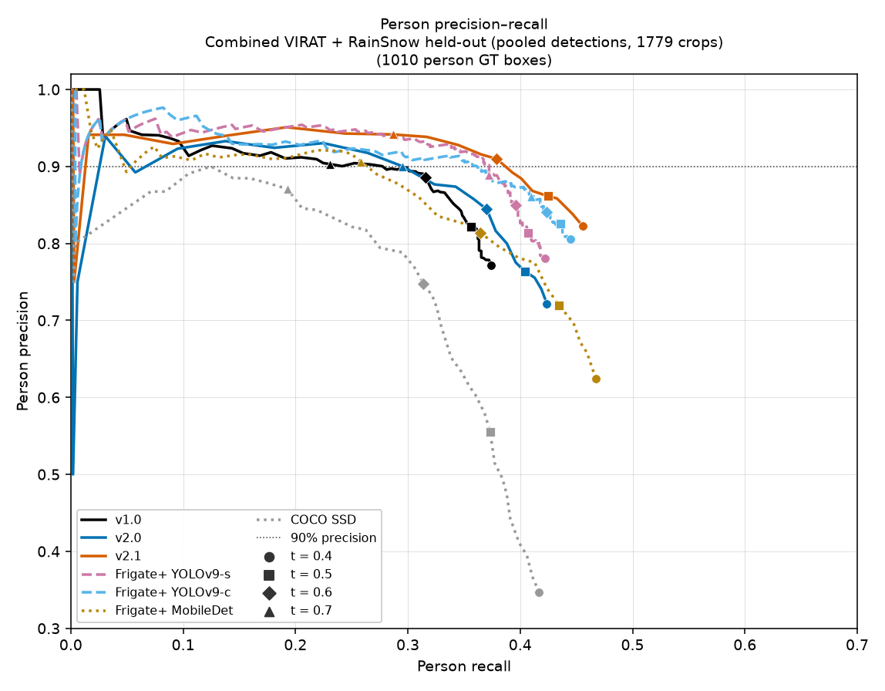

# Accuracy and speed on Frigate-style camera crops (2026-11)

These results compare the YOLOv9-s models from this repository with Frigate's stock Coral model and with
Frigate+ models. Every model was scored with the same pre- and post-processing as Frigate 0.18 and the same scorer.

## v2.1 (2026-11): held-out scenes

v2.1 adds training data cut from the VIRAT and RainSnow sets below, split by scene. It can therefore only be scored
fairly on the scenes it never trained on: VIRAT 0001 / 0401 / 0502 (996 crops) and RainSnow Hjorringvej / Ostre
(783 crops; RS-gray is the same 783 in grayscale). Every model below was re-scored on exactly these crops with the
same harness. These numbers are **not comparable** with the full-set table further down: the held-out VIRAT scenes
are easier for cars and heavier on bicycles. Compare rows only within one table.

| model | nc | VIRAT wAP | pers | car | RainSnow wAP | pers | car | RS-gray wAP | rec. threshold | vs 0.7 | person R at rec. threshold |
|---|---|---|---|---|---|---|---|---|---|---|---|
| **v2.1 (slim r6 2t), this release** | 18 | **74.26** | **61.85** | 94.27 | **24.97** | **11.15** | **49.76** | **18.00** | **0.60** | **−0.10** | **37.9 %** |
| Frigate+ yolov9s ¹ | 46 | 67.86 | 51.50 | 94.28 | 17.63 | 5.28 | 39.53 | 16.41 | 0.75 | +0.05 | 36.0 % |
| Frigate+ yolov9c 640 ¹ ² | 46 | 68.02 | 51.73 | **95.24** | 17.07 | 6.13 | 36.57 | 15.70 | 0.85 | +0.15 | 34.8 % |
| v2.0 (slim r6 2t) | 17 | 65.44 | 48.59 | 92.35 | 17.91 | 6.39 | 38.42 | 12.56 | 0.70 | 0.00 | 29.5 % |
| Frigate+ MobileDet ³ | 46 | 63.73 | 50.44 | 85.94 | 10.49 | 0.48 | 27.95 | 12.86 | 0.70 | 0.00 | 25.8 % |
| v1.0 COCO-only | 17 | 61.43 | 45.09 | 87.43 | 17.09 | 10.56 | 29.25 | 14.17 | 0.70 | 0.00 | 23.1 % |
| MobileDet COCO (Frigate default) ³ | 79 | 57.85 | 39.56 | 88.32 | 10.95 | 3.67 | 23.90 | 9.92 | 0.735 | +0.035 | 12.5 % |

v1.0, v2.0 and v2.1 accuracy is from the int8 TFLite model on a CPU interpreter, which matches the Coral to within
0.35 points (see the check further down). v2.1's 18th class, `animal`, is not scored here: none of these sets label
animals, so animal detections are ignored like any other unscored label.

¹ ONNX fp32 on OpenVINO CPU, not Coral. On the full sets the CPU fp32 yolov9s scored 1–2 wAP higher than its published
Coral row, so read these rows as slightly optimistic for a Coral.
² yolov9c 640 does not fit on a Coral; reference only.
³ CPU TFLite build standing in for the EdgeTPU build. For Frigate+ MobileDet this matched the Coral row to within
0.06 points.

### Recommended thresholds

Frigate's `threshold` (default 0.7) should be adjusted when you change models, because some models are more
"confident" in their scores than others. **rec. threshold** is the lowest score at which person precision stays at or
above 90 % on the combined VIRAT + RainSnow held-out crops (1010 person boxes); **vs 0.7** is how far to move
Frigate's usual 0.7 to get the same 90 % person precision with that model. At its recommended 0.60, v2.1 finds about
8 points more of the people than v2.0 does at 0.70, at the same precision.

Markers show detector scores 0.4 / 0.5 / 0.6 / 0.7 on each curve; the dotted line is 90 % precision.

Caveats:
- Frigate applies `threshold` to a track's median score, not to single detections, so treat these values as a
  starting point and adjust for your cameras.
- The crops always contain objects, so these numbers understate false alarms on empty scenes.
- The detector returns nothing below score 0.4, so no threshold below 0.4 is meaningful.
- RainSnow has only 136 person boxes, so the combined numbers are dominated by VIRAT.

## v2.0 release table (full sets, 2026-11)

| model | nc | source | Coral e2e ms | VIRAT wAP | pers | car | R@.7 | RainSnow wAP | pers | car | RS-gray wAP |
|---|---|---|---|---|---|---|---|---|---|---|---|
| Frigate+ yolov9s (2026-10) | 46 | Coral | **9.51** | **54.35** | 41.15 | 76.40 | **39.3** | 15.62 | 5.48 | 33.67 | 13.50 |
| slim hs (6t) | 17 | CPU int8† / Coral | **9.17** | 52.01 | 39.95 | 71.42 | 29.6‡ | **20.47** | 12.36 | 35.48 | **15.18** |
| fat r6 (ReLU6, DFL head) | 17 | CPU int8 / Coral | **9.04** | 51.69 | 39.64 | 71.13 | 25.5 | 15.61 | 7.13 | 30.88 | 11.00 |
| **slim r6 (2t), v2.0 release** | 17 | CPU int8 / Coral | **6.25** | 51.47 | 39.09 | 71.32 | 26.6 | 17.22 | 8.07 | 33.75 | 11.67 |
| v1.0 COCO-only (ReLU6, DFL head) | 17 | CPU int8* / Coral | **9.16** | 48.52 | 36.77 | 67.32 | 17.1 | 14.94 | 8.18 | 27.31 | 13.09 |
| Frigate+ MobileDet | 46 | Coral | **5.70** | 41.82 | 37.97 | 47.75 | 22.1 | 9.91 | 1.95 | 23.92 | 9.97 |
| MobileDet COCO (Frigate default) | 79 | Coral | **6.81** | 33.23 | 27.39 | 42.13 | 12.3 | 9.44 | 3.54 | 19.99 | 8.85 |

Columns:
- **nc**: number of classes the model outputs. The 17-class models use the COCO subset in `labels-coco17.txt`.
- **Coral e2e ms**: median end-to-end time per frame on a Coral EdgeTPU: set input tensor + invoke + get outputs +
  host-side decode. Lower is better. This is the number to compare for speed; CPU timings are not used.
- **VIRAT / RainSnow / RS-gray wAP**: AP at IoU 0.5 (0-100), averaged over the scored classes with fixed weights
  person 0.61 / car 0.36 / bicycle 0.03, so every row uses the same weights. **pers** and **car** are the per-class AP50.
- **R@.7**: recall on VIRAT at detector score ≥ 0.7. This approximates how often an object passes a typical Frigate
  `threshold`. Note that this threshold can (and should!) be adjusted after installing a new model. Some models are more "confident" in their classification scores than others.
- **source**: where the accuracy numbers come from. "CPU int8 / Coral" means accuracy from the int8 TFLite model on a
  CPU interpreter (see the check below), and speed from a Coral.

## Which model to use (v2.0 release)

For v2.1, see the held-out table above. The notes below compare the v2.0-era models on the full sets.

- **slim r6, 2-tensor layout (2t)** was the model for the v2.0 release. It is about as accurate as the
  older "fat" ReLU6 model on daytime crops (51.5 vs 51.7 wAP), better at night (17.2 vs 15.6), and about 30 % faster
  on the Coral (6.25 vs 9.04 ms). It beats v1.0 on every set except RainSnow gray.
- **slim hs** (hard-swish activations) is more accurate, especially at night and in gray (IR-like) footage,
  but costs about +2.9 ms per frame on the Coral. Use it if accuracy matters more to you than speed.
- Frigate+ yolov9s is still about 2–3 wAP ahead on daytime crops and well ahead on high-confidence recall (R@.7),
  but both slim models beat it at night. Both MobileDet models are behind every YOLO model.

## Data sets

All three sets are 320×320 crops cut the way Frigate itself cuts detector regions around moving objects
(Frigate 0.18 `get_cluster_candidates` / `get_cluster_region` / `calculate_region`, black padding, `INTER_LINEAR`
resize). Scored classes: person, car, bicycle.

- **VIRAT** (daytime outdoor surveillance cameras): 3000 crops from 233 videos in 9 scenes. GT boxes: person 3550,
  car 9908, bicycle 3145. Licensed under the VIRAT Video Dataset Usage Agreement, so the crops are not redistributed.
- **RainSnow** (AAU RainSnow Traffic Surveillance Dataset, CC BY 4.0, Bahnsen & Moeslund, Aalborg University):
  1588 night and dusk crops from 11 sequences, mostly small objects in rain and snow.
- **RS-gray**: the same RainSnow crops converted to grayscale, as a stand-in for IR night footage.
- **Held-out subsets (v2.1)**: VIRAT scenes 0001 / 0401 / 0502 (996 crops) and RainSnow sequences Hjorringvej / Ostre
  (783 crops). v2.1 trained on crops from the other VIRAT scenes and RainSnow sequences, never these.

Frigate+ models use their own label map. To keep the comparison fair, only classes that every model has are scored,
and detections on unscored objects are ignored rather than counted as false positives.

## Notes on the method

\* **v1.0 CPU stand-in.** The released v1.0 file is EdgeTPU-only, so its CPU row uses a CPU int8 export of the same
v1.0 weights. On 2000 COCO images the stand-in scored 62.46 mAP50 on CPU, against 62.69 for the released file on Coral.

† **HS on Coral.** The CPU int8 model runs real HARD_SWISH. On the Coral, hard-swish runs through patched
lookup tables, a method that was bit-exact in earlier checks. This particular HS build has not had its own Coral
accuracy run, so read its accuracy row as "expected on Coral", not "measured on Coral". Its speed (9.17 ms, invoke
8.75 ms) was measured on a Coral (warmup 50, 1000 runs × 5 rounds). On the same Coral, the slim r6 graph measured
5.89 ms invoke, so hard-swish costs about **+2.86 ms** per frame.

‡ **6t vs 2t.** The 6-tensor layout (one box and one class tensor per scale) has per-scale int8 scales, which round
scores near 0.7 a little differently. On r6, 6t and 2t give the same wAP (51.50 vs 51.47) but R@.7 is 29.0 vs 26.6,
so the HS R@.7 is probably about 2 points higher than a 2t HS build would get.

**Slim r6 2t speed.** 6.25 ms e2e (5.88 ms invoke), measured on a Coral with warmup 50, 1000 runs × 5 rounds. This
matches the ~6.3 ms "Inference Speed" Frigate shows with the model live. The 6t, 2t and 1t layouts of the same model
are within 0.1 ms of each other, which is noise; 2t is used because Frigate's YOLO path expects one box and one class
tensor.

**Other rows.** Frigate+ yolov9s (trained 2026-10-15, 320×320, 46 classes), Frigate+ MobileDet and Frigate's
stock MobileDet are EdgeTPU-only. Their rows come from a real Coral run with the same harness and scorer, and so do
the Coral e2e times of the other rows except slim r6 2t and slim hs.

**Harness.** Frigate 0.18 pre- and post-processing, `min_score` 0.001 for AP, NMS IoU 0.4.

### CPU int8 numbers stand in for the Coral

The same models scored on CPU int8 and on a real Coral:

| model | VIRAT wAP CPU / Coral | RainSnow CPU / Coral | RS-gray CPU / Coral |
|---|---|---|---|
| fat r6 | 51.69 / 51.81 | 15.61 / 15.67 | 11.00 / 10.91 |
| v1.0 (CPU stand-in / released file on Coral) | 48.52 / 48.86 | 14.94 / 15.07 | 13.09 / 13.30 |

The gaps are at most 0.35 points, much smaller than the gaps between models.

## Model output layouts

| model family | outputs | box decode |
|---|---|---|
| v1.0 / fat r6 (DFL) | `(1,2100,64)` DFL box logits + `(1,2100,17)` class logits | softmax over 16 bins per side, expectation |
| slim **2t** (v2.0, v2.1) | `(1,2100,4)` ltrb distances + `(1,2100,17)` class logits (`(1,2100,18)` for v2.1) | `max(d, 0)`, no softmax |
| slim 6t (research) | 3 × `(1,H,W,4)` + 3 × `(1,H,W,17)`, per scale | same as 2t, per scale |

All three layouts decode with the same anchors (cell centre + 0.5) and strides (8, 16, 32):
`x1y1 = (anchor - lt) * stride`, `x2y2 = (anchor + rb) * stride`. `frigate_shim.py` in this folder picks the box
decode by the box tensor's channel count (64 → DFL, 4 → ltrb distances).
